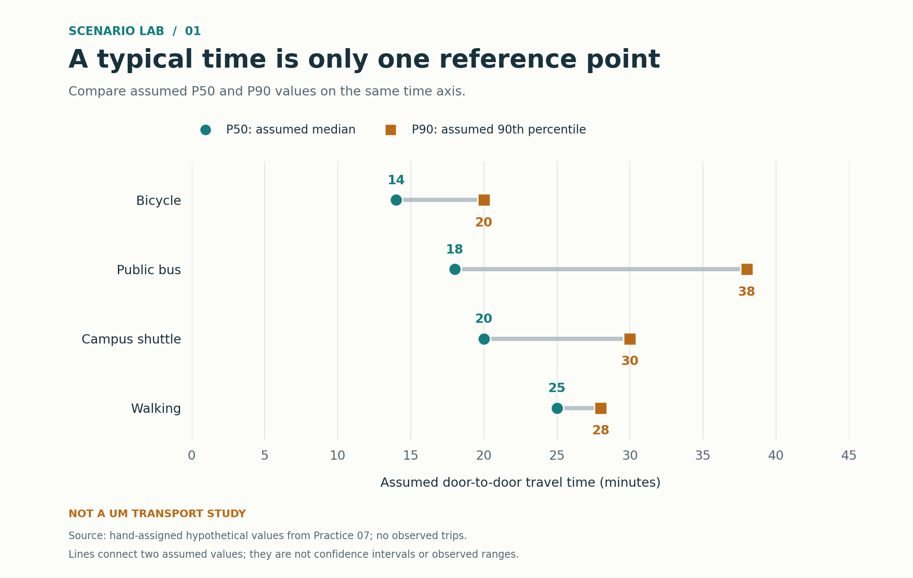
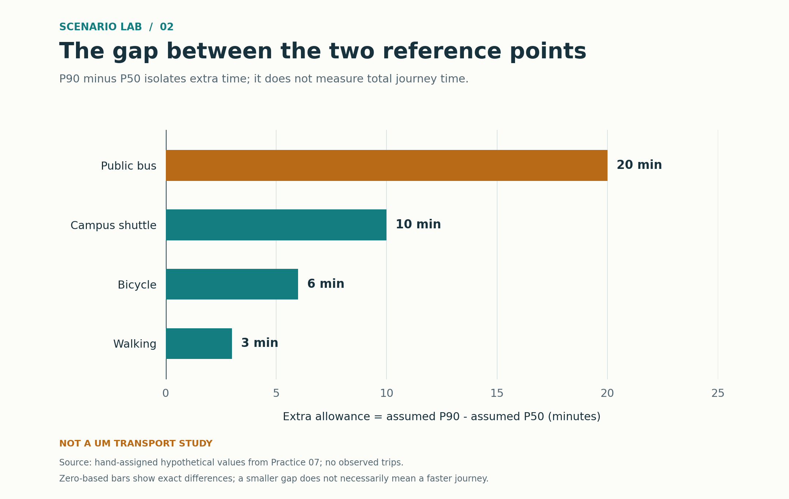

<section class="hero">
  
Data science portfolio / 01

  <h1>Make the comparison. <em>Keep the context.</em></h1>
  

    
<h2>ZHU ZHICHENG</h2>
I am developing my data analysis and visualization skills through CISC7204 coursework. This portfolio connects a focused question to readable charts, reproducible code and explicit limitations.

    

Skills practiced in this project
<ul><li>Python &amp; reproducible scripts</li><li>Matplotlib &amp; visual comparison</li><li>Data validation &amp; unit tests</li><li>GitHub &amp; technical documentation</li></ul>

  

</section>

<section id="project" class="project-section">
  

Selected project / campus commute
Ongoing · classmate review addressed

  <h2 class="section-title">Fast on a typical day. But how much time should you allow?</h2>
  
How does the ranking of four travel modes change when we compare typical journey time with a slower-journey benchmark?

  <aside class="data-note"><strong>Hypothetical data, not a transport study.</strong> These eight time values are hand-assigned for a design exercise. No journeys were observed, and the results are not recommendations about University of Macau transport.</aside>
  <figure>
    
    <figcaption>01 / Typical and slower journeys P50 is the median. P90 is a time threshold within which at least 90% of journeys would finish under the assumed distribution; it is not a guarantee.</figcaption>
  </figure>
  

The finding

The bus is <strong>7 minutes faster</strong> than walking at the median, but <strong>10 minutes longer</strong> at P90. Looking only at the typical trip changes the comparison.

  <aside class="data-note" aria-labelledby="ranking-title">
    <strong id="ranking-title">What changes in the ranking?</strong>
    
<b>At P50, fastest to slowest:</b> Bicycle (14) → Public bus (18) → Campus shuttle (20) → Walking (25).

    
<b>At P90, fastest to slowest:</b> Bicycle (20) → Walking (28) → Campus shuttle (30) → Public bus (38).

    

      <table>
        <caption>Rank changes at a glance — rank 1 is fastest at that benchmark</caption>
        <thead><tr><th scope="col">Mode</th><th scope="col">P50 rank</th><th scope="col">P90 rank</th><th scope="col">Change</th></tr></thead>
        <tbody>
          <tr><th scope="row">Bicycle</th><td>1st</td><td>1st</td><td>No change</td></tr>
          <tr><th scope="row">Public bus</th><td>2nd</td><td>4th</td><td>Down 2 places</td></tr>
          <tr><th scope="row">Campus shuttle</th><td>3rd</td><td>3rd</td><td>No change</td></tr>
          <tr><th scope="row">Walking</th><td>4th</td><td>2nd</td><td>Up 2 places</td></tr>
        </tbody>
      </table>
    

    
All values are assumed minutes. Walking moves from fourth to second, while the bus moves from second to fourth. This compares the supplied reference points, not the chance of one mode beating another on an actual journey.

  </aside>
  <figure class="secondary">
    
    <figcaption>02 / Extra allowance beyond typical time Sorting the gaps makes the additional allowance easy to compare. A short gap does not establish low variance or eliminate extreme delays.</figcaption>
  </figure>
  <a class="button" href="https://github.com/zzc1565545/data-science-project">Explore code, data and README ↗</a>
  

Read the values as a table

<table><caption>Assumed door-to-door journey times (minutes)</caption><thead><tr><th scope="col">Mode</th><th scope="col">P50</th><th scope="col">P90</th><th scope="col">P90 − P50</th></tr></thead><tbody><tr><th scope="row">Bicycle</th><td>14</td><td>20</td><td>6</td></tr><tr><th scope="row">Public bus</th><td>18</td><td>38</td><td>20</td></tr><tr><th scope="row">Campus shuttle</th><td>20</td><td>30</td><td>10</td></tr><tr><th scope="row">Walking</th><td>25</td><td>28</td><td>3</td></tr></tbody></table>

</section>

<section id="methods" class="methods-section">
  
How the result can be checked

  

<h2>Small inputs. Visible decisions.</h2>
The project extends a static visualization exercise into a documented Python analysis. It reads a small JSON dataset, validates each pair of quantiles, calculates P90 minus P50, and creates both charts and a machine-readable summary.

The first chart preserves the actual time values; the second isolates their differences. Neither chart uses a truncated scale or estimates an unknown distribution.

  

Reproduce locally
<pre><code>python -m pip install -r requirements.txt
python analysis.py
python -m unittest -v</code></pre>
Run these commands inside the project repository with Python 3.11 or later. The analysis uses only the bundled hypothetical data; no login, API key or data download is needed.
<a href="https://github.com/zzc1565545/data-science-project#reproduce">Full reproduction instructions →</a>

  

One important limitation

Two assumed quantiles cannot establish the full spread of journey times or the probability of being late. The comparison also leaves out cost, weather, safety, accessibility and service schedules. Real travel advice would need comparable observations and a different study design.

</section>

<section id="next" class="next-section">
  
Review and next steps
<h2>Make the changing ranks visible.</h2>
  
A classmate identified the question, the bus-versus-walking finding and the hypothetical-data limitation. Their suggestion was to show the complete P50 and P90 rankings so readers can see which positions change. The page already contained written rankings; in this follow-up, I added a side-by-side table with each mode's two ranks and its movement. The <a href="https://github.com/zzc1565545/data-science-portfolio/blob/main/PEER_REVIEW.md">classmate feedback record</a> documents the suggestion and this new improvement.

  
Longer term, I would replace the assumed values with consented, comparable observations and examine full distributions before drawing practical conclusions.

  
<strong>AI assistance:</strong> OpenAI Codex assisted with code, visualization design, drafting and checks. The work is presented as AI-assisted coursework, not as an independently conducted transport survey.

</section>
